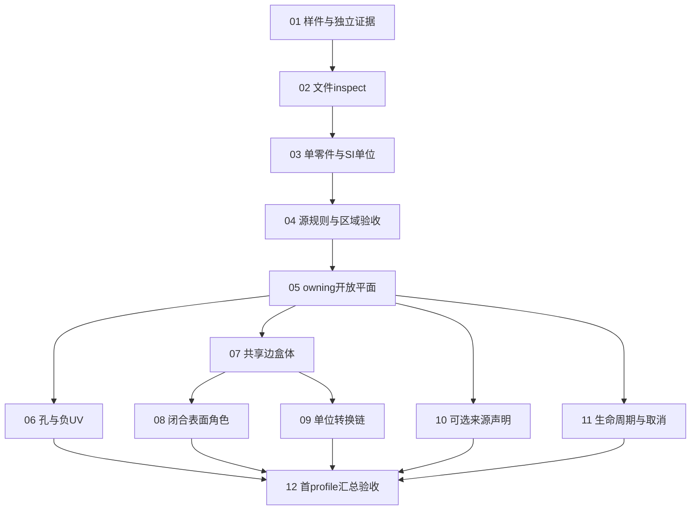

# AP203e2首个profile：本地实施票

2026-10-15用户确认12票拆分及依赖关系；01/02已验收关闭。2026-10-16用户明确授权的03单零件、类型与SI源语义及04必要源规则/平面区域均已实现并验收关闭，codex负责；随后用户授权的05—08已实现并验收。2026-10-17的09单位重述与conversion也已完成，10—12仍未领取/on-hold。

## 状态与执行限制

### 当前实现基线（2026-10-17）

01—04原19条验收及进入05前的核心准备已经完成，详见
[05之前准备完成记录](../../docs/step-import/pre05-readiness.md)。三个STEP目标及其CLI/原生测试
当前以C++20为基线；本页下方C++17与各阶段“后续未开始”描述保留初次验收的历史时点。
随后用户要求按后续计划继续，05已实现并验收关闭；06和07也已完成，见[05验收](../../docs/step-import/ticket05-acceptance.md)、[07验收](../../docs/step-import/ticket07-acceptance.md)；08见[08验收](../../docs/step-import/ticket08-acceptance.md)，09见[09验收](../../docs/step-import/ticket09-acceptance.md)；10—12仍为on-hold。
前置准备的验收不代替05实际native构建与后验检查。

后续核心收尾包括[全局身份](../../docs/step-import/global-rule-identity.md)、
[类型目录](../../docs/step-import/type-profile-catalog.md)、[共享查询](../../docs/step-import/shared-source-queries.md)、
[阶段状态](../../docs/step-import/typed-check-progress.md)、[80项局部身份](../../docs/step-import/local-rule-identity.md)、
[03字段消费](../../docs/step-import/semantic-field-consumers.md)和[有理数不变量](../../docs/step-import/exact-value-invariants.md)。

### 票据状态

- **Status：01—09为closed，其余ready-for-agent**。ready-for-agent不表示已开工。
- **Execution：01—09为completed，10—12为on-hold**。
- **Assignee：01—09为codex，其余None**。09单位重述与conversion已实现并验收；10—12仍保持on-hold。
- Blocked by只列直接技术前置。前置票实际完成验收并关闭后才解除相应阻塞；未执行的验收框保持未勾选。
- 后续明确开工后，先按授权范围更新Execution与负责人再执行；没有新指令时不自动领取frontier。

本地建票使用[to-tickets技能](C:/Users/tangx/.codex/skills/to-tickets/SKILL.md)约定的一票一文件格式。既有Wayfinder设计票、父地图及已确认规格保持原状态；本次没有远端issue或PR；后续实现仅本地提交，未推送。

2026-10-16先新增[01票实施方案与验收步骤](plans/01-fixture-evidence-plan.md)：定义材料/证据、A—H顺序及V01—V12。其“未执行”措辞保留当时设计快照；当前实际状态见下方验收记录。

同日补齐[01内部数据合同与工具控制](plans/01-data-contracts-and-controls.md)：定义文件关系和状态不变量，细化P01/N20/N02以及CTL01—CTL12（含生成与truth共同错误）。这是实施前设计，现已按01完成验证。

同日新增[01工具控制执行清单](plans/01-control-execution-checklist.md)：12组14子场景的设置、指定检查和裁决。

**01实际验收：** [01验收记录](../../docs/step-import/ticket01-acceptance.md)。49项材料/独立核算、14控制、两版Python各28测试通过；303个材料文件双目录字节一致。完整导入仍全部NotRun。

**02实际验收：** [02验收记录](../../docs/step-import/ticket02-acceptance.md)。独立C++17源解析/inspect、不依赖OCCT；49项源检查合同匹配（47 Inspected、N02/N03准确Rejected），两种配置各10组C++检查、两版Python各31测试通过。明确ASCII `2;1`单DATA范围，不授全部Part21/AP/native资格。02完成时累计9条验收完成，依赖边不变。

**03实际验收：** [03验收记录](../../docs/step-import/ticket03-acceptance.md)。独立C++17类型/单零件/SI层，无OCCT读取。49项当前阶段合同匹配：26 Checked、17阻断、6 conversion Deferred；72声明独立对账，两种配置各10组语义＋10组源层检查、两版Python各35测试通过。01/02代码和材料不变；03完成时14条完成、39条未执行，完整导入仍NotRun。

## 正式票与直接依赖

| 票 | Blocked by | 本票独立交付 |
|---|---|---|
| [01：从样件设计得到可重复的独立验收证据](issues/01-fixture-evidence.md) | 无技术依赖 | 固定49项输入、独立真值、mutation谱系及证据调用路径 |
| [02：最小STEP可inspect，文件错误准确定位](issues/02-step-inspect.md) | [01](issues/01-fixture-evidence.md) | 完整源记录/位置和文件、索引、引用错误报告 |
| [03：单零件、类型与SI单位的源语义可检查](issues/03-product-context-si-units.md) | [02](issues/02-step-inspect.md) | 唯一产品/表示/context的可追踪解释及SI单位检查 |
| [04：平面的必要规则与有向区域可独立验收](issues/04-planar-source-validation.md) | [03](issues/03-product-context-si-units.md) | 最小平面的规则、方向及区域准入证据或明确反证 |
| [05：从STEP交付owning只读开放平面](issues/05-owning-planar-import.md) | [04](issues/04-planar-source-validation.md) | 完整只读模型快照、来源、报告与普通失败清理 |
| [06：带孔面与负UV原点保持源区域](issues/06-holes-and-uv-origin.md) | [05](issues/05-owning-planar-import.md) | 孔、参数原点、UV/window与查询贯通 |
| [07：从盒体STEP保留共享边和材料实体](issues/07-shared-edge-solid-box.md) | [05](issues/05-owning-planar-import.md) | 共享边身份、材料实体、方向、内外和独立几何查询 |
| [08：同形闭合表面保留surface-model角色](issues/08-closed-surface-role.md) | [07](issues/07-shared-edge-solid-box.md) | 同边界的solid与surface-model有不同材料资格 |
| [09：单位重述与conversion链保持物理几何](issues/09-unit-conversion-fidelity.md) | [07](issues/07-shared-edge-solid-box.md) | 厘米、英寸、源参数与conversion量纲/尺度处理 |
| [10：可选来源声明与旧AP203类型完整保留](issues/10-optional-source-declarations.md) | [05](issues/05-owning-planar-import.md) | uncertainty、category、sr及旧context/source原型完整保留 |
| [11：生命周期、取消与限额不留下部分结果](issues/11-lifecycle-cancellation-limits.md) | [05](issues/05-owning-planar-import.md) | owner/view/副本、合作取消、限额和失败资源证据 |
| [12：汇总49项端到端证据并限定首profile资格](issues/12-profile-qualification.md) | [06](issues/06-holes-and-uv-origin.md)、[08](issues/08-closed-surface-role.md)、[09](issues/09-unit-conversion-fidelity.md)、[10](issues/10-optional-source-declarations.md)、[11](issues/11-lifecycle-cancellation-limits.md) | 组合分支、单位环及49项真实执行证据和资格边界 |

**04实际验收：** [04验收记录](../../docs/step-import/ticket04-acceptance.md)。独立STEP_PLANAR，无OCCT/SMLib读取或构建依赖。49当前合同匹配（11源证据Checked、32准确阻断、6 conversion Deferred）；规则5/1/41、方向/区域及误差独立对账。C++17 Debug/Release与STEP闭包C++20检查通过，两版Python各35测试；全49的17/20输出相同。05未开始，完整导入仍NotRun。

**05实际验收：** [05验收记录](../../docs/step-import/ticket05-acceptance.md)。C++20内部owning开放平面，F1面积96/边界40/1F4E4V/参数与查询通过；独立native一致性、后装UV、五阶段tol、普通失败及视图/报告生命期均验收。两配置各9组CLI通过，49合同为1Accepted/25Rejected/17Unsupported/6Deferred；01—04及冻结材料不改。

**06实际验收：** [06验收记录](../../docs/step-import/ticket06-acceptance.md)。带孔单开放平面、负UV与源原点、逐loop/use实际UV身份通过；P02/P03均为88mm²/52mm。双配置各14组CLI及7个CTest目标通过；49合同为3Accepted/25Rejected/15Unsupported/6Deferred，01—05回归保持，07—12未开工。

**07实际验收：** [07验收记录](../../docs/step-import/ticket07-acceptance.md)。材料矩形盒体的真实共享边、逐面UV/外向侧/邻接、6F12E8V/24源使用、面积2200/体积6000与内外/距离通过。两配置各6个最终原生CTest目标、19组CLI通过；有限边界体积证据P1已修正并复审关闭，旧组件回归按源码身份复用；08—12未开工。

**08实际验收：** [08验收记录](../../docs/step-import/ticket08-acceptance.md)。P05同形闭合表面保留源角色/表示链与共享边界，实际native材料区域为0，材料体积/内外分类不适用，不依拓扑谓词升级实体；双配置各11个CTest目标、23组CLI及普通失败清理通过。09—12未开工。

**09实际验收：** [09验收记录](../../docs/step-import/ticket09-acceptance.md)。P06/P07厘米重述、P11精确127/5转换与canonical几何贯通，源LINE t不缩放、PLANE UV专属映射；量纲源反证和零负/环项目诊断分开。双配置各13个CTest目标、142项核心Python和28组CLI通过，316个旧预算边界不变；49项为8 Accepted/29 Rejected/12 Unsupported，10—12未开工。

共15条直接阻塞边；所有前置票编号均小于依赖它的票，依赖无环。53条原验收条件文字保持；01的4条、02的5条、03的5条、04的5条已完成，加05的5条、06的4条、07的4条、08的3条、09的4条，共39条；其余14条未执行。

## 票组共同约束与来源

当前范围为AP203e2 N2635首个平面／盒体profile；内部C++/inspect/导入验证入口优先，GUI、公开SM_API/Python、worker隔离及后续几何/AP/修复能力沿总体规格推进。

- 产品读取链路完全自研；OCCT只可作为允许的独立测试对照，不能进入产品读取/转换链路。
- 采用Source snapshot→内部中立模型→受控SMLib构建；Imported model snapshot默认只读，Import report与实际输入、profile、Q及版本一致。
- Repair=None；来源规范化、派生UV与容差变化均须有证据。13正例/36反例已冻结并通过材料/数学核验，产品导入仍NotRun。
- 单mutation可产生多个连带反证；首个阻断、源错误、Unsupported和未判定按已有诊断合同区分。失败不交付本次模型，不改原有已发布结果。
- 首profile采用36种simple叶与六complex签名，所有壳面均为ADVANCED_FACE；普通FACE_SURFACE及原schema访问问题的边界保持不变。
- 未覆盖的全部Part21载体、其他AP、开放共享片/全sense组合、截面/建模及工程故障，不因本票组完成而自动成为已支持或整个P1/P2通过。
- 生产默认质量数值、真实60/20/8选样与模型库长跑不由建票授权；测试候选Q和真实能力晋升仍依已有门槛。

依据：[已确认总体规格0.1](../../docs/step-import-repair-spec.md)、[首profile合同](../../docs/step-import/ap203e2-planar-profile.md)、[样件设计总册](../../docs/step-import/ap203e2-sample-design.md)、[反例与预期诊断](../../docs/step-import/ap203e2-sample-cases.md)、[领域术语](../../GLOSSARY.md)。原审阅拆分保留于[breakdown](breakdown.md)，正式状态与直接依赖以本索引和独立票为准。

## 建档与校验范围

建票时仅整理Markdown、53条验收及15条依赖。随后用户分别授权01/02/03/04，交付固定语料/独立证据工具、STEP_SOURCE、STEP_SEMANTICS和STEP_PLANAR；具体范围见各自验收记录。已确认规格0.1和原Wayfinder地图/设计票保持原样。
