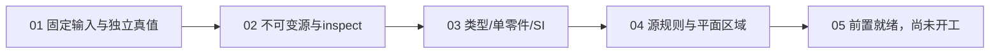

# 进入05之前的准备完成记录

2026-10-16（Asia/Shanghai）。当前任务是完成首个AP203e2封闭profile在05及SMLib构建之前的准备，
并未授权执行05。01—04的19条原验收、当前核心架构收尾及进入05所需设计材料已逐项核对；
05仍未领取/未开工，后续native验收保持NotRun。

这里的完成范围是本票组进入05的前置，不能替代总体规格P0/P1/P2退出或完整STEP支持。

## 当前可交付的检查链路

- 产品路径自研，仅STEP_SOURCE、STEP_SEMANTICS、STEP_PLANAR及标准库，不使用OCCT读取。
- 三个目标在CMake与Premake均以C++20为基线；SMLib及全仓编译标准未迁移。
- 当前载体为自包含ASCII Part21、`2;1`、单DATA；profile为N2635、36种simple叶与六complex签名。
- 49个固定输入在04得到11 Checked、15 Rejected、17 UpstreamFailure、6 Deferred。
  Checked是源规则/区域证据；所有模型仍为null，native_build/full_import仍为NotRun。
- 01的13正/36反输入与303个材料、独立数学、原mutation和诊断合同保持，不改写冻结真值。

## 01—04逐条验收对账

原条件见[01](../../.scratch/ap203e2-planar-import/issues/01-fixture-evidence.md)、
[02](../../.scratch/ap203e2-planar-import/issues/02-step-inspect.md)、
[03](../../.scratch/ap203e2-planar-import/issues/03-product-context-si-units.md)、
[04](../../.scratch/ap203e2-planar-import/issues/04-planar-source-validation.md)。
本表不改动原条件或把未来native结果算成通过。

| 条目 | 已完成的要求 | 当前可核对证据 |
|---|---|---|
| 01-1 | 49项固定字节、唯一ID、谱系与mutation | 原manifest；材料复现、全部负例编辑重放检查 |
| 01-2 | 独立精确几何与身份真值 | 独立平面/盒体数学、反例反证、原始定义/拓扑检查 |
| 01-3 | 质量、来源、诊断版本及未执行状态 | Q/诊断篡改控制；未执行产品观察不能被伪造 |
| 01-4 | 选择单例可读且范围明确 | 三个单例路径、选择/父例检查、14个工具控制 |
| 02-1 | 完整准入HEADER/DATA与原值/引用 | 49源合同、全部ValueKind/原词元及complex组成检查 |
| 02-2 | 基础51记录、N02/N03和半图阻断 | 冻结源合同、重复ID/悬空引用及后部错误不发布图 |
| 02-3 | 前向/乱序/稀疏ID与完整范围 | 前向/重排/大ID/循环及完整正反索引检查 |
| 02-4 | 捕获后源不变与限额/明确拒绝 | 原生源所有权合同；输入/节点/深度/记录/报告边界与载体/编码反例 |
| 02-5 | 已支持载体和未支持范围区分 | ASCII单DATA之外明确Unsupported；阶段/完整导入仍NotRun |
| 03-1 | 名称/OID绑定N2635，APD另存 | schema/OID/APD/year独立合同 |
| 03-2 | 唯一产品链、祖先与constituent | 49语义合同、diamond/complex检查、单零件与重排/稀疏身份检查 |
| 03-3 | SI、派生槽及参数量纲分开 | 全SI前缀、rad/sr、derived槽、conversion显式字段/Deferred检查 |
| 03-4 | 范围反例及未知必需内容准确阻断 | N01、N04—09、N14/15等冻结合同，未知实体与角色/形状准入反例 |
| 03-5 | 全范围反向索引与语义完整标志 | whole-file反向角色、RI过滤使用闭包、限额不发布部分Snapshot |
| 04-1 | 相关祖先/TYPE/局部与47全局规则 | 独立77实体＋3TYPE来源/顺序/owner；47项及5/1/41人口合同 |
| 04-2 | SDR/PDR、LOOP、RI及UNKNOWN | G36/G47反控；未求值和源UNKNOWN分别验证，原schema支路不私改 |
| 04-3 | LINE/PLANE、sense、区域与残差 | 49独立数学；N19—24等反例、16组sense、孔/相交/参数/误差边界 |
| 04-4 | 首个阻断与后果/Unsupported区分 | 冻结诊断合同、多违反首错/字段定位及后续NotRun检查 |
| 04-5 | 资格限定与无native执行 | 全49输出model=null，转换六例Deferred，上游失败不进入04 |

最新完整回归同时执行四个模块：
`tools.step_import_validation.tests.test_validation`（28）、
`tools.step_inspect_validation.tests.test_inspect`（31）、
`tools.step_semantic_validation.tests.test_semantics`（38）、
`tools.step_planar_validation.tests.test_planar`（41），共138项，无跳过。
原生CTest在Debug/Release各执行12源、18语义、15平面合同组。
具体源/语义/数学比较仍各自独立，未改测试包协议或发布/复核机制。

## 核心架构收尾

| 准备项 | 完成情况与记录 |
|---|---|
| 报告有界写入与源位置 | [共享Writer与位置验收](report-mechanics-refactor-acceptance.md)；当前回归继续检查报告字节预算及捕获失败位置 |
| 全局规则稳定身份 | [47项登记](global-rule-identity.md)，存储顺序不再决定算法或执行次序 |
| 封闭profile类型目录 | [类型目录](type-profile-catalog.md)，声明、complex/SELECT/派生槽解释集中 |
| 字段/引用事实与所有权 | [共享查询](shared-source-queries.md)，04复用03；不复制实体图 |
| 检查阶段 | [私有类型化进度](typed-check-progress.md)，呈现字符串不控制执行 |
| 全部局部身份 | [77实体＋3TYPE](local-rule-identity.md)，三个驱动及全部预算行为保持 |
| 03自身消费绑定 | [产品/闭包/单位迁移](semantic-field-consumers.md)，原始槽位校验与后期解释分开 |
| 有理数不变量 | [规范数值](exact-value-invariants.md)，只读分数事实、受控构造；原容量与运算不改 |

数值失败归因已核实为现有检查责任实体：NumericDiagnostic沿最后一次Tick的owner，
不承诺精确指向导致容量耗尽的最底层数值词元。超容量仍为Indeterminate、没有舍入接纳。
将其细化为逐数值字段来源会改变诊断合同，是独立改进候选，未发现它阻断本profile进入05；
本次遵守既有“诊断保持”要求，不以拆函数或改变量名冒充已完成来源机制改造。

## 05已具备的设计输入

05的唯一直接依赖是04，当前已完成。首个实现对象与测量规则均已具名：

| 设计输入 | 位置与05必须遵守的内容 |
|---|---|
| F1与独立真值 | [平面样件](ap203e2-sample-plane.md)、[独立真值](p0-planar-cases.md)：面积96、边界40、旋转坐标、点分类/查询和有向身份 |
| 固定STEP与Q | 原P01输入及quality/Q-P0-mm-01.json；不能从native控制重填真值 |
| 质量字段 | 定义误差1e-8mm、一致性/派生UV误差1e-7mm、显式T0=1e-5mm、工作tol上限1e-4mm、干净例增长0；均为测试值 |
| 分层与参数 | [首片合同](p0-planar-slice.md)、[构建来源审计](p0-smlib-source-audit.md)：源参数/单位/方向独立保留，中立解释不含native指针 |
| 目标几何/UV/window | 保持定义线/面，native几何按owner独立拥有，后装SAME-owner UV，证明完整有限域包含并核对实测参数 |
| 所有权与提交 | 候选context独立，Repair=None；必需报告和后验核验成立才发布只读owning结果，普通失败清理不泄露半模型 |
| native运行门槛 | 构建审计N01—N10明确列为P2待执行；旧合成DLL探针不替代05的新STEP端到端证据 |

当前step_planar::Quality只承载源一致性检查需要的字段，不是完整native导入质量配置。
05须兑现上述完整Q字段和实际有效tol的测量，不能把当前consistencyMm或源uncertainty当作全部精度设置。
本轮核对SMLib/SM_API自构建来源审计固定提交以来无源码差异；没有加载、构建或运行内核来假称05通过。

## 留在05及后续的工作

| 票/阶段 | 尚未执行的内容 |
|---|---|
| 05 | STEP→中立解释→真实native F1；独立查询、UV/window/工作tol、owning结果和普通失败清理 |
| 06—08 | 带孔与负UV、共享边盒体、材料实体与闭合surface-model角色 |
| 09—12 | conversion、可选源声明端到端、取消/生命周期/资源和完整49项导入资格 |
| 总体后续 | 其他AP/Part21载体、一般精确BRep、修复、生产配置、模型库/跨平台/worker及总体P0—P7退出 |

上述内容不是本轮跳过的前置验收，而是原票据中05及后续的交付；其状态继续NotRun/on-hold。
当前不会接纳一个native模型或对外宣称完整AP符合性。

## 当前验证与冻结锚点

最新验证在本地`C:/Users/tangx/Documents/Codex/2026-10-13/usd/work/step-research/exact-value-invariants/`：
validate.py/validation.json记录C++20两配置、138项、196次样件和169次预算边界逐字节同旧；
旧可写接口的编译合同失败与新接口通过均有日志。3个Release CLI的运行依赖已另行检查，
没有OCCT/SMLib/USD/STEPcode。所有源码变化均经过Standards与Spec两项审查，当前无未解决发现。

最终逐项审计已核验受测源码哈希、138个实际测试名与四模块计数、19条原条件未被改写、
15条直接依赖及05—12的on-hold状态、冻结锚点和当前P01的model=null/native NotRun。
本地`pre05-final-audit.py`及`pre05-final-audit.json`保存对应检查与结果；这些是本机核验记录，不是新打包协议。

| 冻结对象 | SHA256 |
|---|---|
| 规格0.1 | 9a6f364e38eeb43fee5bb7b05e151eb7102cc80f402ae24f508adc55a566d6fa |
| 01 manifest | 6305839e767a4884858f6b2b19df32c2644a0ca2f49d10cee50b834050bc1f82 |
| 03声明见证 | 95eaed220c9e638f8f94c6e9429c2b562668ad643070efa77f26b8b305b29a58 |
| 04规则见证 | 970d8ac65d56cad561004e72865fb3340000a6431e967b9a9bc9bd98cc6639b6 |

进入05的前置项已完成；实际05的Accepted结果及SMLib执行仍没有产生。后续从05票明确定义的F1验收开始。
